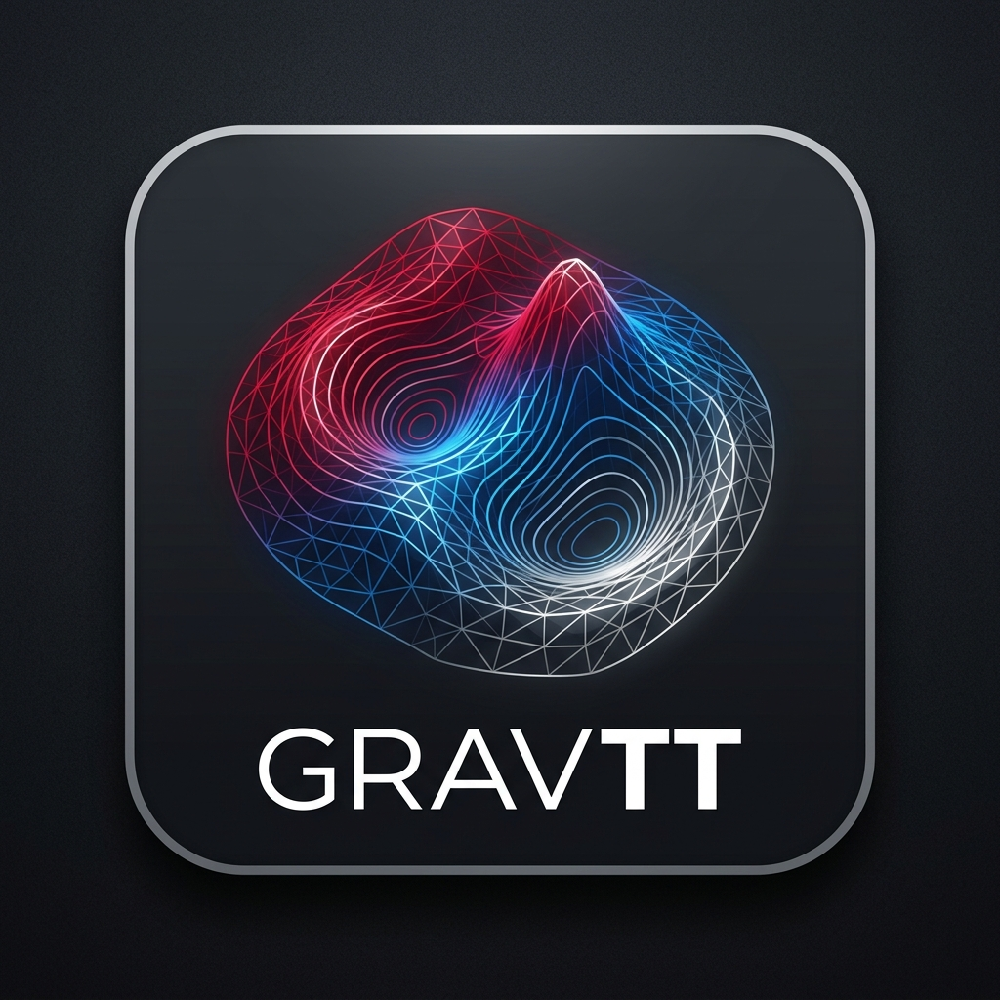

# GravTT - Suite Geofísica de Procesamiento Gravimétrico, Interpolación 2D y Análisis Fourier

<p align="center">
  
</p>

<p align="center">
  <b>Software integral de cálculo, modelado geofísico 2D y análisis espectral para campos potenciales gravitatorios y topográficos.</b>
</p>

<p align="center">
  
  
  
  
</p>

---

## 🌟 Características Principales

**GravTT** reúne en una interfaz técnica optimizada de alto rendimiento todas las etapas del procesamiento gravimétrico moderno:

### 1. 📐 Reducción Gravimétrica Secuencial
* **Gravedad Teórica Normal ($g_0$):** Modelos elipsoidales de referencia internacionales (WGS84, GRS80, Hayford 1924, Internacional 1967).
* **Corrección de Aire Libre (FAC):** Gradiente vertical normal de gravedad con altura elipsoidal u ortométrica.
* **Corrección de Placa de Bouguer (SBC):** Densidad de corteza configurable ($\rho = 2.67\ \text{g/cm}^3$ por defecto).
* **Corrección de Terreno Topográfico (TC):** Integración numérica eficiente de prismas topográficos a partir de Modelos Digitales de Terreno (MDT GeoTIFF) sin dependencias pesadas de GDAL/Rasterio.

### 2. 🗺️ Generación e Interpolación de Mallas 2D
* Conversión de observaciones dispersas e irregulares a mallas rectangulares regulares sincronizadas.
* Algoritmos de interpolación integrados:
  * **TIN (Triangulación Delaunay con interpolación lineal)**
  * **Kriging Ordinario** con modelado automático de semivariograma esférico/gaussiano.
  * **Inverso de la Distancia Ponderada (IDW)** con potencia ajustable ($p$).
  * **Curvatura Mínima / Splines Biarmónicos**.
  * **Funciones de Base Radial (RBF)** (Multicuádricas, Thin Plate Spline).

### 3. 🌊 Análisis y Filtrado Espectral 2D por FFT
* **Acondicionamiento Perimetral (Tapering 2D):** Ventanas de transición suave (Coseno Hann/Tukey, Hermite S-Curve, Rampa Lineal) para eliminar el efecto de borde y la fuga espectral (*spectral leakage*) antes de la FFT.
* **Filtros Espectrales en Cascada:**
  * Continuación hacia arriba (*Upward Continuation*) y hacia abajo (*Downward Continuation*).
  * Derivadas espaciales verticales (Primera y Segunda Derivada Vertical, 1VD y 2VD).
  * Gradiente Horizontal Total (THDR).
  * Filtros Pasa-Bajos, Pasa-Altos y Pasa-Banda tipo Butterworth y Gaussiano.
* **Espectro de Potencia Radialmente Promediado (RAPS):** Estimación de profundidad de fuentes anómalas a partir de pendientes en escala logarítmica $\ln(P)$ vs número de onda $k$.

### 4. 🧲 Problema Inverso por Fuentes Equivalentes (Z0)
* Inversión de anomalías observadas sobre una topografía accidentada mediante una capa equivalente de fuentes a profundidad constante $z_0$.
* Formulación por Mínimos Cuadrados Amortiguados (*Damped Least Squares - DLS*) con regularización de Tikhonov.
* Continuación hacia arriba y hacia abajo a planos de observación sintéticos sin discontinuidades topográficas.

### 5. 🔬 Modelador Sintético hacia Adelante (Blakely 1995)
* Modelado geológico teórico según las formulaciones clásicas de *Richard J. Blakely (1995), Capítulo 11*.
* Fuentes sintéticas 3D elementales:
  * Esferas homogéneas / monopolos.
  * Cilindros horizontales y verticales.
  * Diques y prismas de extensión finita e infinita.
* Superposición de múltiples cuerpos en el dominio de Fourier con modulación de fase espacial $\exp(-i(k_x x + k_y y))$.
* Opción de añadir ruido blanco gaussiano para ensayos de robustez.
* Comparador pixel a pixel entre observaciones de campo y modelos sintéticos con evaluación algebraica $f(\text{Obs}, \text{Mod})$.

### 6. 🖥️ Visualizador Maestro 2D y Multi-Monitor
* Paletas científicas perceptualmente uniformes (`viridis`, `plasma`, `turbo`, `terrain`, `seismic`, etc.).
* Trazado automático de curvas de nivel (contornos) con etiquetado dinámico de valores.
* Desacoplamiento de gráficos a ventanas flotantes independientes para configuración multi-monitor.
* Inspector continuo de coordenadas $(X, Y)$ y valores de anomalía bajo el cursor.

---

## 🚀 Instalación y Requisitos

### Requisitos Previos
* **Python 3.9 o superior** (probado en Python 3.9, 3.10, 3.11, 3.12 y 3.14).
* Sistema Operativo: Windows 10 / 11, Linux o macOS.

### 1. Clonar el Repositorio
```bash
git clone https://github.com/TU_USUARIO/GravTT.git
cd GravTT
```

### 2. Crear un Entorno Virtual (Recomendado)
En Windows (PowerShell):
```powershell
python -m venv venv
.\venv\Scripts\Activate.ps1
```

En Linux / macOS:
```bash
python3 -m venv venv
source venv/bin/activate
```

### 3. Instalar Dependencias
```bash
pip install -r requirements.txt
```

---

## ⚡ Ejecución Rápida

### En Windows
Puedes simplemente hacer doble clic en el archivo por lotes:
```bat
GravTT.bat
```
O ejecutar desde terminal:
```bash
python GravTT.py
```

---

## 📁 Estructura del Proyecto

```text
GravTT/
├── assets/
│   ├── logo.png                # Logotipo oficial de GravTT en alta resolución
│   └── icon.ico                # Ícono de aplicación multiresolución
├── ejemplos/
│   ├── anomalia_esfera.csv     # Ejemplo de prueba con anomalía de esfera
│   └── andes97.xyz             # Datos de estaciones gravimétricas de prueba
├── GravTT.py                   # Módulo y ventana principal de la aplicación
├── GravTT.bat                  # Acceso directo para ejecución en Windows
├── corrector_gravimetrico.py   # Módulo de reducciones gravimétricas y GeoTIFF
├── problema_inverso_fuente_equivalente.py  # Inversión por fuentes equivalentes
├── modelador_sintetico_blakely.py          # Modelado analítico y comparador (Blakely)
├── requirements.txt            # Dependencias del proyecto
├── .gitignore                  # Archivos ignorados para control de versiones
├── LICENSE                     # Licencia de código abierto MIT
└── README.md                   # Documentación del proyecto
```

---

## 📊 Formatos de Datos Soportados

| Tipo de Datos | Extensiones | Contenido |
|---|---|---|
| **Puntos Dispersos** | `.csv`, `.xyz`, `.txt`, `.dat`, `.xlsx` | Columnas $X, Y, Z$ (o Lat, Lon, Gravedad / Cota). Delimitadores por coma, punto y coma, tabulador o espacios. |
| **Modelos de Elevación (MDT)** | `.tif`, `.tiff` | GeoTIFF estándar con etiquetas de georreferenciación (PixelScaleTag y TiepointTag). |
| **Mallas de Exportación** | `.csv`, `.xyz`, `.txt`, `.tif` | Grilla regular matricial con coordenadas y valores calculados. |

---

## 📚 Referencias Bibliográficas

1. **Blakely, R. J. (1995).** *Potential Theory in Gravity and Magnetic Applications*. Cambridge University Press.
2. **Telford, W. M., Geldart, L. P., & Sheriff, R. E. (1990).** *Applied Geophysics*. Cambridge University Press.
3. **Grant, F. S., & West, G. F. (1965).** *Interpretation Theory in Applied Geophysics*. McGraw-Hill.
4. **Dampney, C. N. G. (1969).** *The equivalent source technique*. Geophysics, 34(1), 39-53.

---

## 📄 Licencia

Este proyecto se distribuye bajo la licencia **MIT**. Consulta el archivo [LICENSE](LICENSE) para más detalles.
